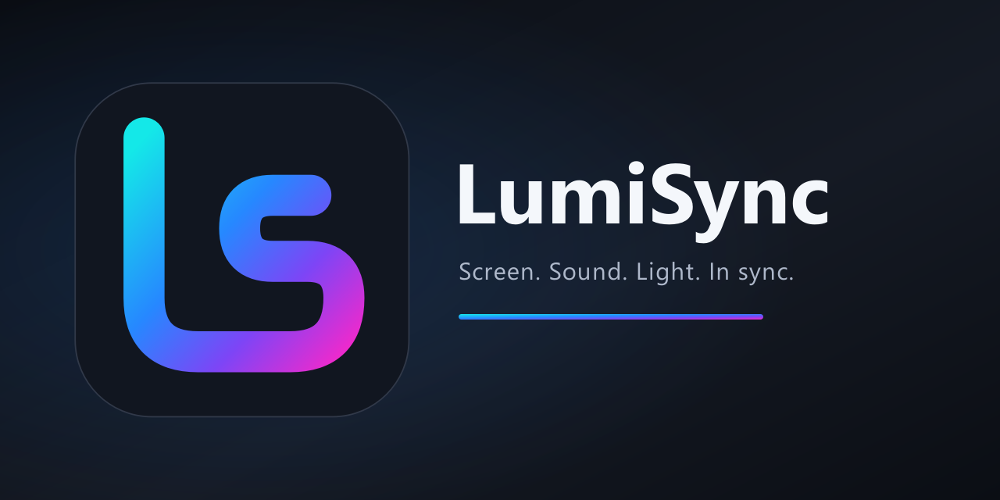
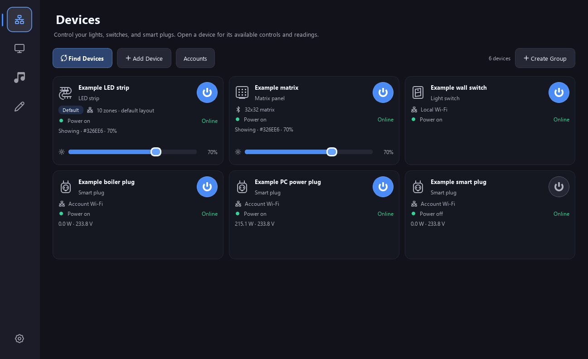
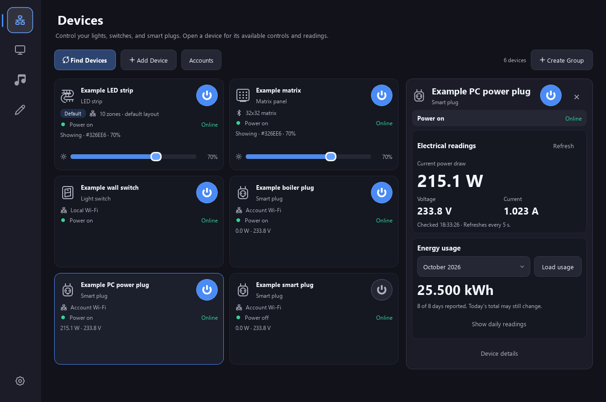
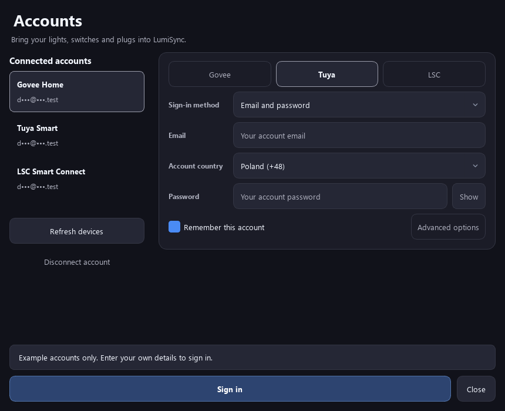
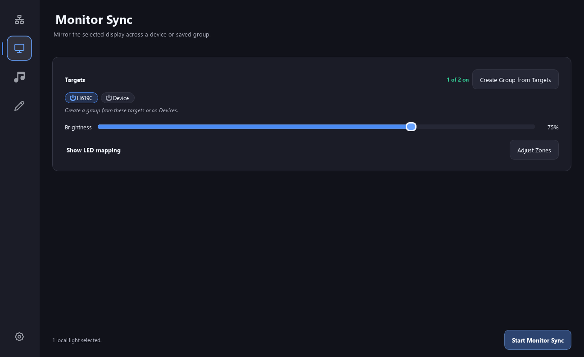
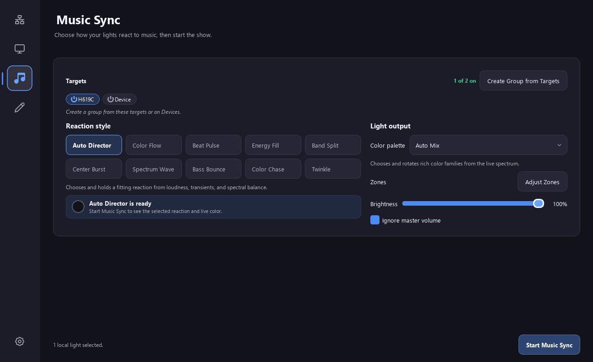

<div align="center">



# LumiSync

**Control your lights, switches and smart plugs. Sync local lights with your screen or music.**

Visit the website: [lumisync.minlor.net](https://lumisync.minlor.net)

[](https://www.python.org/downloads/)
[](https://pypi.org/project/lumisync/)
[](https://opensource.org/licenses/MIT)
[](https://github.com/Minlor/LumiSync/stargazers)

[Features](#features) • [Installation](#installation) • [Usage](#usage) • [Development](#development) • [Roadmap](#roadmap) • [Changelog](CHANGELOG.md)

</div>

---

> [!NOTE]
> LumiSync 1.0 supports Windows and Linux X11. Monitor sync on Wayland is experimental (see the platform notes); macOS screen capture is not supported yet.

## Features

| Feature | Description |
|---------|-------------|
| **Monitor Sync** | Map screen regions to compatible local lights, with display selection and custom LED layouts |
| **Music Sync** | Choose audio reactions and palettes, or use Auto Director |
| **Device controls** | Power, brightness, color and white temperature appear only where supported; switches and plugs get appropriate controls |
| **Personal accounts** | Govee, Tuya Smart and LSC email/password; Govee API keys; Tuya/Smart Life QR authorization |
| **Plug metering** | Device-reported watts, volts and amps; monthly energy history and daily readings on supported Tuya/LSC plugs |
| **Panel tools** | iDotMatrix drawing, animation, clock, rotation, countdown and scoreboard |
| **Find Devices** | Refresh local discovery, every linked account and saved readings together; match authorized Tuya devices to local addresses |
| **Desktop UI** | Device type icons, adaptive cards and inspector, keyboard controls, and Acrylic, Mica or Solid Dark materials |

### Supported devices

The dependencies for these transports ship with a single install. Device
support depends on its firmware, capabilities, and the account's authorization.

| Family | Transport | Notes |
|--------|-----------|-------|
| Govee strips/bulbs | LAN (UDP), account MQTT, Platform API | LAN for sync; account/API connections for manual controls |
| iDotMatrix panels | Bluetooth LE | Drawing, animations, clock, rotation, countdown, scoreboard; sync uses an ambient colour |
| LSC / Tuya WiFi lights, switches and plugs | Tuya LAN, personal account or Smart Life QR | LSC/Tuya Smart email/password; authorized local-key import; controls follow the device schema; RGBIC strips (Battletron, wall washers) sync up to 20 colour zones, see below; supported plug metering |
| Gigabyte RGB Fusion 2 motherboards | USB HID (Windows and Linux; Linux needs a udev rule, see the platform notes) | Found by Find Devices; power, brightness and one colour for the whole board, also as a sync target; verified on the B550 AORUS ELITE (IT5702, `048D:5702`) under Windows and under Linux (WSL2 kernel with USB passthrough; not yet on a native Linux desktop) |
| Logitech G502 HERO mouse (wired) | USB HID++ 2.0 (Windows; Linux untested and needs a udev rule, see the platform notes) | Found by Find Devices and Scan this PC; power, brightness and colour for the whole mouse (logo and DPI lights), with colour correction and an optional per-zone layout (DPI lights and logo each get their own colour during sync), also as a sync target; fixed colour, breathing and colour cycle with a speed, and an optional separate logo colour; no Logitech software needed. Verified on a wired G502 HERO (`046D:C08B`) under Windows with G HUB running, which may put its own colour back when its profile changes; not yet tried with G HUB closed or on Linux |
| Lorgar AZAR keyboard | USB HID (Windows; Linux untested and needs a udev rule, see the platform notes) | Found by Find Devices and Scan this PC; one static colour for the whole keyboard or one of its 17 built-in effects (with speed, direction and multicolour where the effect has them), brightness and power, set from the PC page. Monitor and Music sync only after turning on "Monitor and Music sync" on its card: the whole keyboard follows one colour, with updates limited (every 10 s by default) because the keyboard saves every change to its memory, which wears it |

See [account setup](#account-setup). LSC and Tuya Smart password login
use built-in client configuration; no Android package, installation or developer
account is required. Each brand uses its own account
namespace: choose the service and country used in your phone app. LumiSync
suggests a country from your computer's region; you can change it before signing
in. Account routing is automatic, and account lists partially hide email addresses.

Cloud connections provide manual controls. Screen and music sync use supported
local connections. Meter readings and history depend on the device schema,
firmware and account service; missing measurements are shown as not reported.
Voltage and current are live readings; historical energy is measured in kWh.

RGBIC strips sync per zone where the hardware allows it: the LSC Battletron and
wall-washer strips, and newer LSC RGB/IC strips, accept one colour per zone.
LumiSync streams them through the LSC app's own UDP fast channel where the
strip supports it (falling back to the paint data point over TCP otherwise),
so screen and music sync run at the vendor's own refresh cadence. The paint
data point varies per product and is often absent from the cloud schema, so
LumiSync probes for it on the first sync and remembers it for later runs; use
Adjust Zones on a card or Adjust Zone Count in the sync views to pick a number
below the 20-zone maximum. Strips without the data point follow sync as one
averaged ambient colour, like LSC bulbs.

## Screenshots

Screenshots show LumiSync 1.0.0 with **example devices, accounts and readings**.

### Devices

<div align="center">


<sub>Recognize each device type and use the controls it supports.</sub>
</div>

### Accounts and plug readings

Sign in with your own account and choose its country from a dropdown. Opening
a supported plug refreshes its electrical readings every five seconds while
visible; monthly energy totals and daily readings load on demand.



<details>
<summary>Account sign-in and connected accounts</summary>



</details>

### Monitor and music sync

<table>
  <tr>
    <td width="50%">
      
    </td>
    <td width="50%">
      
    </td>
  </tr>
  <tr>
    <td align="center"><strong>Monitor Sync</strong><br/>Map display colors across one or more lights.</td>
    <td align="center"><strong>Music Sync</strong><br/>Choose reactions and palettes or let Auto Director decide.</td>
  </tr>
</table>

## Installation

Prebuilt Windows and Linux downloads do not require a separate Python install.
Installing from PyPI or source requires **Python 3.11 or higher**.

### From PyPI (Recommended)

```bash
pip install lumisync
```

### From GitHub (Latest)

```bash
pip install git+https://github.com/Minlor/LumiSync.git
```

### Development Install

```bash
git clone https://github.com/Minlor/LumiSync.git
cd LumiSync
uv sync --frozen --group dev
uv run lumisync
```

`uv.lock` is committed so every checkout and release build resolves the same
dependency versions.

### Building the Windows installer

`tools/build_windows.ps1` builds the onedir bundle and — when
[Inno Setup 6](https://jrsoftware.org/isinfo.php) is installed —
`dist/LumiSync-Setup.exe`. Pass `-SkipInstaller` for a local onedir-only build
without Inno Setup. The release workflow installs Inno Setup and publishes the
installer and `LumiSync-Windows-SHA256SUMS.txt`.

### Release signing (maintainers)

The in-app updater installs a release only when
`LumiSync-Windows-SHA256SUMS.txt.sig` (for the AppImage,
`LumiSync-Linux-SHA256SUMS.txt.sig`) is a valid Ed25519 signature, by a key
listed in `lumisync/update_keys.py`, over the checksum manifest and the release
version. Each release workflow signs its manifest with the `UPDATE_SIGNING_KEY`
repository secret and fails if no key is pinned or the secret is missing or
does not match. Local builds are never signed. While `UPDATE_PUBLIC_KEYS` is
empty, the app logs a warning and checks only the release's own checksum.

- **Create the key** (once), outside the repository:
  `uv run python tools/update_signing.py keygen --private-key-out PATH --write-public`.
  It prints the public key and adds it to `lumisync/update_keys.py`; commit
  that. Then `gh secret set UPDATE_SIGNING_KEY < PATH`, keep an offline copy
  of the private key, and delete `PATH`.
- **Check a release by hand**:
  `uv run python tools/update_signing.py verify --manifest LumiSync-Windows-SHA256SUMS.txt --signature LumiSync-Windows-SHA256SUMS.txt.sig --version 1.0.1`.
- **Rotate the key**: generate a new key with `--write-public` (the old key
  stays listed) and ship a release still signed with the old key. From the
  next release, set `UPDATE_SIGNING_KEY` to the new key; once most installs
  have updated, remove the old public key.
- **Key lost**: installs that only know that key can no longer update in the
  app. Pin a new key, publish the release signed with it, and tell users to
  install that release from the releases page once.
- **Key leaked**: replace the secret and pin a new key at once, remove the
  leaked public key in that release, and tell users to install it from the
  releases page, because older installs still trust the leaked key until they
  update. Delete any release asset you did not publish.

### Prebuilt downloads

- **Windows** — **`LumiSync-Setup.exe`** is attached to each
  [GitHub release](https://github.com/Minlor/LumiSync/releases). It installs
  per-user under `%LOCALAPPDATA%\Programs\LumiSync`, so it does not need an
  administrator prompt, and it adds Start Menu/uninstall entries. Its optional
  **Allow LumiSync through Windows Firewall** task asks for administrator
  approval once to add an inbound rule for private networks, so LumiSync can
  hear Govee and LSC/Tuya lights; if you skip it, the Devices page offers
  **Allow** later.
- **Linux** — an `x86_64` **AppImage** is attached to each release. Download
  **`LumiSync-x86_64.AppImage.tar.gz`** and extract it to get an AppImage that
  runs straight away (`tar -xzf LumiSync-x86_64.AppImage.tar.gz`). The plain
  `LumiSync-x86_64.AppImage` needs `chmod +x` first, because no browser
  download keeps the executable bit. Build it yourself with `tools/build_linux.sh` (needs Python 3.12+,
  `uv`, and the Qt X11 runtime libraries listed in
  [the Linux build workflow](.github/workflows/linux-release.yaml)). The
  AppImage requires glibc 2.35 or newer (Ubuntu 22.04+). Linux releases are
  checked by opening the packaged GUI on X11 in a clean Ubuntu 22.04 runtime.
  Keep the AppImage in a folder you own (for example `~/Applications`) and
  LumiSync updates it in place, after checking the download against the
  release's signed `LumiSync-Linux-SHA256SUMS.txt`; other Linux installs open
  the release page instead.
  A Flatpak is scaffolded in `packaging/flatpak/` but
  not yet finished.

> **Windows SmartScreen:** release builds are not code-signed yet. If Windows
> shows "unknown publisher", choose **More info → Run anyway**. Code signing is
> planned for a future release.

> **Platform notes:** Windows is fully supported. On Linux, device control,
> music sync, and manual control work on X11 and Wayland. Screen (monitor)
> sync works on X11/Xorg; **on Wayland it is experimental**. It shares the
> screen through the desktop's screen-sharing portal and PipeWire, so it needs
> `xdg-desktop-portal` with your desktop's backend (GNOME, KDE or wlr),
> PipeWire, and GStreamer's PipeWire plugin:
>
> - Debian/Ubuntu: `sudo apt install gstreamer1.0-pipewire gstreamer1.0-tools`
> - Fedora: `sudo dnf install pipewire-gstreamer`
> - Arch: `sudo pacman -S gst-plugin-pipewire`
>
> The desktop's sharing dialog asks once which screen to share (and remembers
> it where the desktop supports that); the Display setting applies only on
> Windows and X11. Without these packages Monitor sync says what to install.
> Wayland capture has so far been verified on a headless wlroots session only,
> not yet on GNOME or KDE. macOS screen capture is not supported.
>
> **Music sync on Linux:** "Current Artwork" colours come from the playing
> MPRIS player's cover and need `busctl` (systemd) or `gdbus` (GLib).
> Keeping the lights independent of the system volume needs `pactl`
> (PulseAudio or PipeWire's `pipewire-pulse`); outputs with hardware volume
> are left alone.
>
> **Firewall on Linux:** if ufw or firewalld is active, it may block the
> replies from Govee (UDP 4002) and LSC/Tuya (UDP 6667) lights. When a search
> then finds no local devices, the Devices page explains why and can copy the
> commands that open those ports; LumiSync never changes the firewall itself.

> **PC lighting on Linux:** the Gigabyte board's lighting controller, the
> Logitech mouse and the Lorgar keyboard are `/dev/hidraw` devices that only root can open by default.
> Find Devices still lists them, but LumiSync can only drive them once a udev
> rule gives your user access. Install the rules from
> [`packaging/linux/60-lumisync-pc-lighting.rules`](packaging/linux/60-lumisync-pc-lighting.rules)
> once:
>
> ```bash
> sudo cp packaging/linux/60-lumisync-pc-lighting.rules /etc/udev/rules.d/
> sudo udevadm control --reload
> sudo udevadm trigger
> ```
>
> (or reboot instead of the last two commands). The AppImage cannot install
> the rules itself; this step is needed once per machine, with any build. The
> Logitech mouse and Lorgar keyboard drivers have not been run on Linux yet;
> their rules are there so they can be tried.

## Usage

### Launch the App

```bash
lumisync
```

The GUI opens by default. Headless mode is available through
`lumisync --monitor` and `lumisync --music`; both read the same sync settings
the GUI writes.

### Quick Start

1. **Connect or discover.** Open Devices → Accounts for Wi-Fi account control. Find Devices refreshes linked accounts, local discovery and saved readings together.
2. **Select your devices.** Use device cards and the inspector. Find Devices also matches imported Tuya devices to their LAN addresses.
3. **Control your devices.** Power, brightness, color, white-temperature and meter controls appear where the device supports them.
4. **Start syncing.** Choose local connections in the device inspector, then open Monitor Sync or Music Sync. Cloud connections offer manual controls.

### Account setup

Open **Devices → Accounts**, choose Govee, Tuya or LSC, then enter your email
and password. For Tuya and LSC, select the country used for your account.
LumiSync suggests your computer's region and handles account routing. Enter
an email verification code if the service requests one.

Tuya Smart and LSC accounts are separate. Smart Life uses **Tuya → QR sign-in**:
copy the user code from the phone app's **Account and Security** settings,
request a QR code, scan it and approve. The approval screen names Home Assistant
because LumiSync uses that public device-sharing registration; no Home Assistant
installation is needed. Govee also offers an **API key** method.

**Remember this account** saves its session in the OS credential store.
Passwords and verification codes are not saved, and account labels mask emails.
Use **Find Devices** to refresh linked accounts and local devices together.

Tuya and LSC sign-in configuration is included. No Android package,
Android installation or developer account is needed.

### Interface

- **Devices** — Discover lights, switches and plugs; connect vendor accounts, choose local/cloud connections, create groups, and view supported electrical readings and energy history.
- **Monitor Sync** — Map display colors to selected devices, groups, zones, and custom LED regions. A brightness boost lifts dim and midtone content without changing hue.
- **Music Sync** — Choose reactions, palettes, targets and brightness, or use Auto Director.
- **PC** — Lighting inside or attached to this computer: Gigabyte RGB Fusion 2 motherboard lighting (colour, brightness, colour correction and per-zone layout) the Logitech G502 HERO mouse (colour, brightness, colour correction, per-zone layout, fixed colour, breathing or colour cycle with a speed, and an optional separate logo colour) and the Lorgar AZAR keyboard (one colour or a built-in effect, brightness and power; a sync target only after opting in on its card, as one colour with limited updates, because every change wears the keyboard's memory). The page finds this hardware by itself while it is open; **Scan this PC** looks again at once, without a network search (Windows and Linux).
- **Draw** — Paint still images or frame-by-frame animations for compatible iDotMatrix panels. The device inspector's Panel Tools opens clock, countdown, scoreboard, and rotation controls.
- **Settings** — Four tabs, General, Sync, Updates and About: choose Acrylic, Mica or Solid Dark; tune sync, startup and system-tray behavior; check for updates (one-click download/install on Windows and for an AppImage in a folder you own); About shows your version, account setup, the logs folder and links to the repository, the author's GitHub and Ko-fi.

The UI adapts to short/narrow windows: account actions and sync Start/Stop stay
visible, Draw tools reflow above the canvas, and the Settings tabs stay above
the scrolling content. Daily readings and technical details expand on demand.

### Configuration

- **LED Mapping** - Customize which screen regions map to which LEDs
- **Brightness** - Adjust per-mode brightness (10-100%), plus a 100-150% tone-map boost for Monitor Sync. "Brightness per light" dims or brightens individual lights (10-100% of the mode's brightness); a light's level is shared by Monitor and Music Sync
- **Display Selection** - Choose which monitor to capture (multi-monitor support; Windows and X11 only, on Wayland the desktop's sharing dialog picks the screen)
- **Sync Tuning** - Tune smoothing, saturation, frame rate, gamma and music response

### Troubleshooting

If a connection or command fails, open **Settings → About → Open logs folder**.
Connection logs and native crash diagnostics are kept there. Try **Find Devices**
to refresh linked accounts and local status. Vendor verification challenges may
require a code or completing sign-in in the phone app; see [account setup](#account-setup).

## Development

### Project Structure

```
lumisync/
├── lumisync.py          # Entry point & CLI
├── connection.py        # Govee UDP protocol (port 4001/4002)
├── devices.py           # Device discovery & caching
├── accounts/            # Vendor sign-in, credential vault & energy history
├── drivers/             # LAN, Bluetooth and account device adapters
├── config/options.py    # Runtime configuration
├── sync/                # Monitor & music sync engines
├── gui/                 # PySide6 application
│   ├── controllers/     # Business logic (QObject + Signal)
│   ├── views/           # UI components
│   └── widgets/         # Reusable widgets
└── utils/               # Logging, colors, file ops
```

### Run Tests

```bash
python -m unittest discover -s tests -t .
```

### Brand and documentation assets

The production app icon, transparent mark, tray variants, Windows `.ico`, and
GitHub banner live in [`assets/brand`](assets/brand). Regenerate the complete
icon set from its single SVG geometry with:

```bash
python tools/generate_brand_assets.py
```

Regenerate the README and website screenshots with isolated example data and
no device or account requests:

```bash
python tools/capture_example_screenshots.py
```

The separate `tools/capture_readme_screenshots.py` utility captures your live
application setup; review those images for private details before sharing.

### Platform Support

| Platform | Screen Capture | Status |
|----------|---------------|--------|
| Windows | dxcam | ✅ Full support |
| Linux (X11) | mss | ⚠️ Partial |
| Linux (Wayland) | xdg-desktop-portal + PipeWire (GStreamer) | 🧪 Experimental |
| macOS | - | ❌ Not supported |

## Roadmap

- [x] Multi-device support
- [x] Govee, Tuya Smart and LSC personal accounts
- [x] Device capability controls and supported plug metering
- [x] iDotMatrix drawing and display tools
- [x] Wayland screen capture (experimental, through the screen-sharing portal)
- [ ] Wayland capture verified on GNOME and KDE
- [ ] macOS screen capture
- [x] Basic color control mode
- [ ] Custom sync algorithms
- [ ] Plugin system for community extensions

## Credits

- **[Wireshark](https://wireshark.org/)** — Protocol analysis
- See [pyproject.toml](pyproject.toml) for all dependencies

## License

[MIT](LICENSE) © Minlor

---

<div align="center">

**[minlor.net](https://minlor.net)** · **[GitHub @minlor](https://github.com/minlor)**

⭐ Star this repo if you find it useful!

</div>
